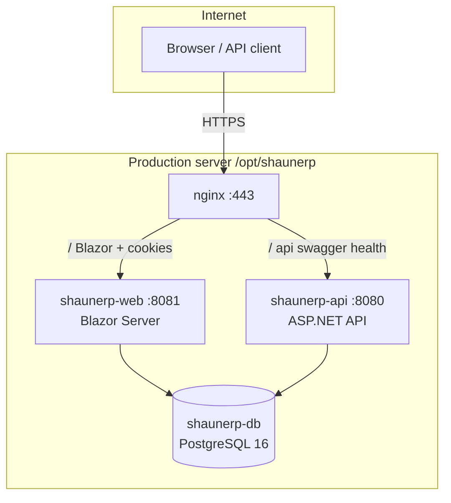

# System Architecture

## Logical architecture

## Application layers

### ShaunERP.Core

Domain entities and platform metadata:

- `ModuleCatalog`, `PermissionCatalog`, `ModuleKeys`
- Entity models: Identity, CRM, Finance, Sales, Accounting, HRMS, Projects

No infrastructure dependencies.

### ShaunERP.Infrastructure

- `ShaunErpDbContext` — single EF Core context for all modules
- Service implementations: auth, CRM, finance, sales orders, accounting, reports, posting
- `ITenantContext`, `IAuthorizationContextService`, `IAuditService`
- `DbSeeder` — schema bootstrap (`EnsureCreatedAsync` + raw SQL patches)

Registered via `DependencyInjection.AddInfrastructure()`.

### ShaunERP.Web

Blazor Server host:

- Cookie authentication (`CookieAuthenticationDefaults.AuthenticationScheme`)
- Data Protection keys persisted to `/app/keys` (Docker volume `shaunerp_web_keys`)
- Direct DB access through infrastructure services (no HTTP call to API for UI)
- Routes defined on `.razor` pages (`@page`)

### ShaunERP.Api

REST API host:

- JWT Bearer authentication
- Swagger/OpenAPI (disabled when `DISABLE_SWAGGER=true`)
- CORS policy `AllowAll` (known security gap)
- Health endpoint: `GET /health`
- Controllers: Auth, Companies, Users, Roles, CRM, Finance

## Request flow — Web UI

1. User posts credentials to `POST /account/login`.
2. `AuthSessionService` validates against `Users` (BCrypt), builds claims via `AuthorizationContextService`.
3. Cookie issued; on each request, middleware hydrates `ITenantContext` from principal.
4. Blazor pages inject services (`ICrmService`, `IAccountingService`, etc.) which scope queries to `CompanyId`.

## Request flow — API

1. Client obtains JWT via `POST /api/auth/login`.
2. JWT includes claims: `sub`, permissions, entitlements, `company_id`.
3. Middleware sets `ITenantContext` from authenticated principal.
4. Controllers delegate to same infrastructure services as the Web app.

## Database initialization (hybrid — **PARTIAL**)

| Mechanism | Used for |
|-----------|----------|
| `EnsureCreatedAsync()` | Initial database creation from EF model |
| Raw SQL in `DbSeeder` | Incremental columns/tables (CRM extensions, finance, sales orders, accounting) |
| `PlatformFoundation` migration file | Exists but **not** applied via `Database.Migrate()` at startup |

This hybrid approach is suitable for development but is a **P0 production blocker** for controlled upgrades (see [PRODUCTION-READINESS-REPORT.md](PRODUCTION-READINESS-REPORT.md)).

## Module registry

`IModuleRegistry` reads `ModuleCatalog.All` to drive:

- Module switcher in shell header
- Dynamic sidebar navigation
- Permission and entitlement checks per nav item

## Cross-module integrations

| From | To | Mechanism | Status |
|------|-----|-----------|--------|
| Sales Order | Invoice | `ISalesOrderService.CreateInvoiceFromOrderAsync` | **COMPLETE** (UI) |
| Invoice | Accounting | `IAccountingPostingService` on invoice post | **COMPLETE** |
| CRM Customer | Invoice | `CustomerId` on `Invoice` | **COMPLETE** |
| Quote | Sales Order | `QuoteId` on `SalesOrder` | **COMPLETE** (UI) |
| Lead | Prospect / Customer | CRM conversion APIs & UI | **COMPLETE** |

## Background processing

**None.** No hosted services, queues, or schedulers. All work is synchronous on HTTP/Blazor circuit threads.

## External dependencies

- PostgreSQL (container `db`, hostname inside Docker network)
- Optional: Cloudflare DNS in front of Lightsail/nginx
- Let's Encrypt via certbot for TLS certificates

## Security boundaries

| Asset | Exposure |
|-------|----------|
| PostgreSQL | Docker internal network only |
| API/Web ports | `127.0.0.1` only; public access via nginx |
| JWT secret / DB password | Environment variables; see [docs/private/PRODUCTION-CREDENTIALS.md](private/PRODUCTION-CREDENTIALS.md) |
| Swagger | Public when not disabled |

## Testing

`tests/ShaunERP.Tests` includes tenant isolation, accounting, and module registry tests. Not a full E2E suite.
