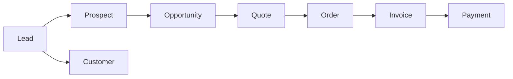

# CRM Module

**Status:** ✅ **COMPLETE** (API + UI + permissions)

## Purpose

Enterprise-style CRM for Shaun Infomedia: lead capture through customer lifecycle, pipeline management, marketing campaigns, quotes, service cases, and activity tracking.

## Lifecycle

| Stage | Entity | Status |
|-------|--------|--------|
| Lead | `Lead` | ✅ Full CRUD + conversion |
| Prospect | `Prospect` | ✅ |
| Account | `CrmAccounts` | ✅ B2B hierarchy |
| Contact | `Contact` | ✅ Linked to account/customer |
| Opportunity | `Opportunity` | ✅ Pipeline stages, win/lose |
| Customer | `Customers` | ✅ Bill-to party for finance |
| Quote | `Quote` + `QuoteLine` | ✅ |
| Sales Order | `SalesOrder` | ⚠️ CRM link via quote; orders module separate |
| Invoice | `Invoice` | ✅ Via finance module |
| Payment | `InvoicePayment` | ✅ Via finance module |

**Partial wiring:** Quote → Order → Invoice path works in UI but not all automations (e.g. auto-create order on quote accept) are implemented.

## Feature inventory

| Feature | UI | API | Notes |
|---------|----|----|-------|
| Dashboard stats | ✅ | ✅ `GET /api/crm/dashboard` | |
| Pipeline board | ✅ | ✅ `GET /api/crm/pipeline` | Kanban by stage |
| Forecast | ✅ | ✅ `GET /api/crm/forecast` | Weighted pipeline |
| Leads | ✅ | ✅ CRUD + convert | |
| Prospects | ✅ | ✅ | |
| Accounts | ✅ | ✅ | Parent/child accounts |
| Contacts | ✅ | ✅ | |
| Opportunities | ✅ | ✅ + win/lose/stage | |
| Customers | ✅ | ✅ | Links to finance |
| Campaigns | ✅ | ✅ | |
| Products | ✅ | ✅ | Used on quotes/invoices |
| Quotes | ✅ | ✅ | Line items |
| Cases | ✅ | ✅ | Service desk |
| Tasks | ✅ | ✅ | |
| Meetings | ✅ | ✅ | |
| Calls | ✅ | ✅ | |
| Notes | ✅ | ✅ | Polymorphic related entity |

## Tenant isolation

All CRM entities carry `CompanyId`. `CrmService` filters by `ITenantContext.CompanyId`. Tests: `TenantIsolationTests.cs`.

## Permissions

Granular per entity: view/create/update/delete (e.g. `crm.leads.create`). See `PermissionCatalog`.

## Demo data

Rich demo seed (`DbSeeder.SeedRichDemoDataAsync`) creates `DEMO-*` and `CUST-DEMO-*` records tagged `demo-seed`. **Remove for production** (see [16-PRODUCTION-OPERATIONS.md](16-PRODUCTION-OPERATIONS.md)).

## Integration points

| Consumer | Usage |
|----------|-------|
| Finance | `CustomerId`, `ProductId` on invoice lines |
| Sales Orders | `CustomerId`, `QuoteId` |
| Accounting | Customer name on AR; no separate CRM ledger |

## Not in scope (PLANNED)

- Email/calendar sync (Outlook, Gmail)
- Marketing automation workflows
- Territory management rules engine
- Mobile app
- Import/export (see [10-IMPORT-EXPORT.md](10-IMPORT-EXPORT.md))

## API reference

Full endpoint list: [20-API-ENDPOINTS.md](20-API-ENDPOINTS.md) § CRM.
