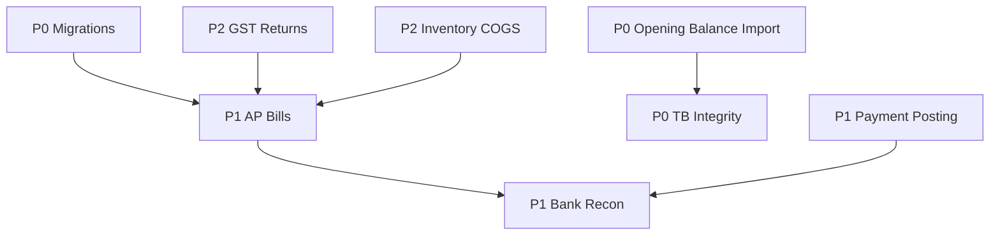

# Accounting Gap Analysis

Prioritized backlog for ShaunERP accounting module.  
**Legend:** P0 = production blocker · P1 = required for full operations · P2 = important · P3 = nice-to-have

## P0 — Production blockers

| # | Gap | Current state | Target |
|---|-----|---------------|--------|
| P0-1 | **Schema migration pipeline** | `EnsureCreatedAsync` + ad hoc SQL in `DbSeeder` | EF migrations + `Migrate()` with version tracking |
| P0-2 | **Opening balance bulk load** | Manual UI entry only | CSV import validated and posted as OB vouchers ([10-IMPORT-EXPORT.md](10-IMPORT-EXPORT.md)) |
| P0-3 | **Demo data separation** | Demo company + seed pollutes production DB | Production init without demo admin/seed |
| P0-4 | **Period lock enforcement audit** | Implemented in posting service | Verify all integration paths (invoice post, payment post) respect lock — regression tests |
| P0-5 | **Trial balance integrity** | Reports from posted vouchers | Automated test: TB debits = credits after sample postings |

## P1 — Required for complete books

| # | Gap | Current state | Target |
|---|-----|---------------|--------|
| P1-1 | **Accounts payable / vendor bills** | `Vendor`/`Bill` stubs; payables report limited | Vendor master, bill entry, PV posting, AP ageing |
| P1-2 | **Payment receipt → accounting** | Partial via finance services | Consistent RV posting on every `InvoicePayment` with bank/cash ledger selection |
| P1-3 | **Credit notes / debit notes** | Not implemented | Document type + reversal posting pattern |
| P1-4 | **REST API for accounting** | Web-only services | `/api/accounting/*` for vouchers, ledgers, reports |
| P1-5 | **Audit trail completeness** | Partial (settings, post, ledgers) | All voucher create/update/post/reverse; export audit |
| P1-6 | **CoA import** | Manual / schema seed | CSV import for groups + ledgers |
| P1-7 | **Bank reconciliation** | Bank book report only | Unmatched statement import + reconcile UI |
| P1-8 | **TDS / withholding** | Not implemented | TDS sections, deduction on PV, certificates (India) |

## P2 — Important enhancements

| # | Gap | Current state | Target |
|---|-----|---------------|--------|
| P2-1 | **GST return exports** | GST settings + output tax posting | GSTR-1 / 3B JSON or Excel export |
| P2-2 | **Multi-branch / cost centers** | Single company profile | Branch dimension on voucher lines |
| P2-3 | **Inventory + COGS** | Item masters only | Stock journal, valuation, COGS on invoice |
| P2-4 | **Fixed assets & depreciation** | Not implemented | Asset register, monthly JV |
| P2-5 | **Budget vs actual** | Not implemented | Budget by ledger/FY period |
| P2-6 | **Report export** | On-screen only | PDF/Excel for TB, P&L, BS |
| P2-7 | **Concurrent voucher numbering** | Sequential in service | DB sequence / advisory lock hardening |
| P2-8 | **Finance GL stub removal** | Deprecated `Finance.Account` | Migrate references to `Ledgers` only |

## P3 — Future / nice-to-have

| # | Gap | Notes |
|---|-----|-------|
| P3-1 | Consolidation multi-company | Group reporting |
| P3-2 | Parallel reporting standards | Ind AS vs tax books |
| P3-3 | E-invoice IRN integration | India NIC portal |
| P3-4 | AI categorization of expenses | |
| P3-5 | Approval workflows for vouchers | Draft → approve → post |

## Cross-module dependencies

## Completed (for reference) ✅

- Chart of accounts (groups + ledgers) with system seed
- Voucher types JV/RV/PV/CV
- Draft/post/reverse voucher lifecycle
- GST settings and tax rate masters
- Financial year + period lock
- Opening balance UI (manual)
- Reports: GL, TB, P&L, BS, day/cash/bank books, AR ageing
- Invoice → sales voucher automation
- Payables report skeleton (limited without bills)

## Recommendation for Shaun Infomedia go-live

**Minimum:** Close P0 items + P1-1 (AP basic) + P1-5 (audit) + P1-6 (CoA import) before treating accounting as production-grade.

**Accept for phase 1:** AR-only operations if AP handled externally until P1-1 ships.

See [PRODUCTION-READINESS-REPORT.md](PRODUCTION-READINESS-REPORT.md) for overall scorecard.
